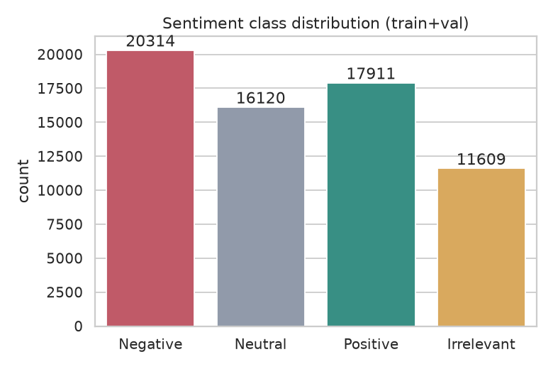
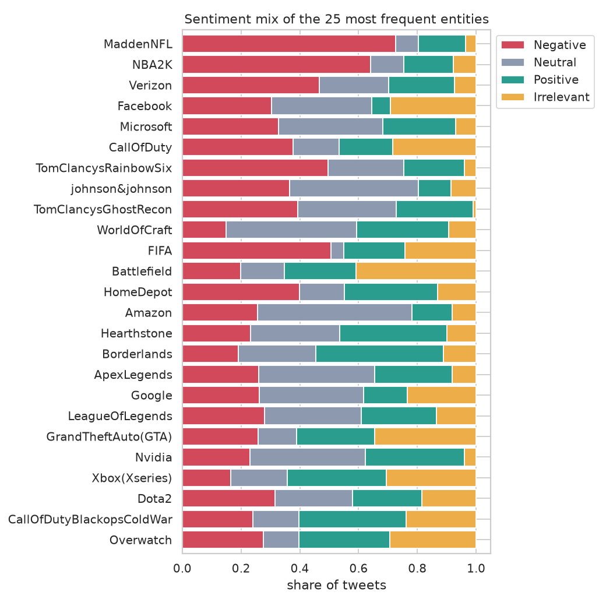
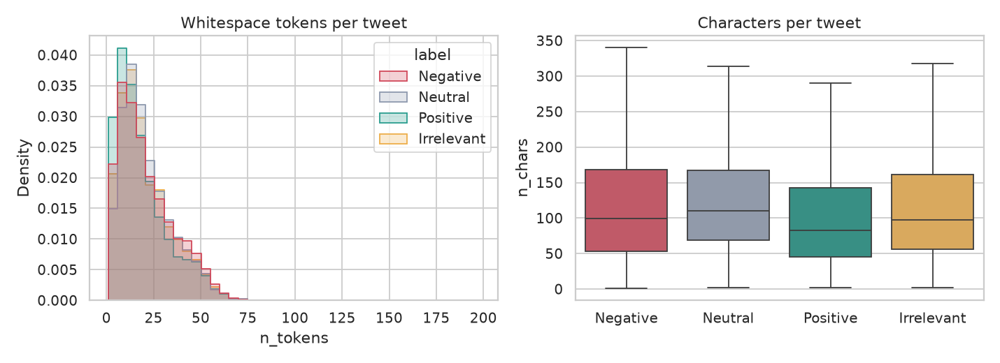
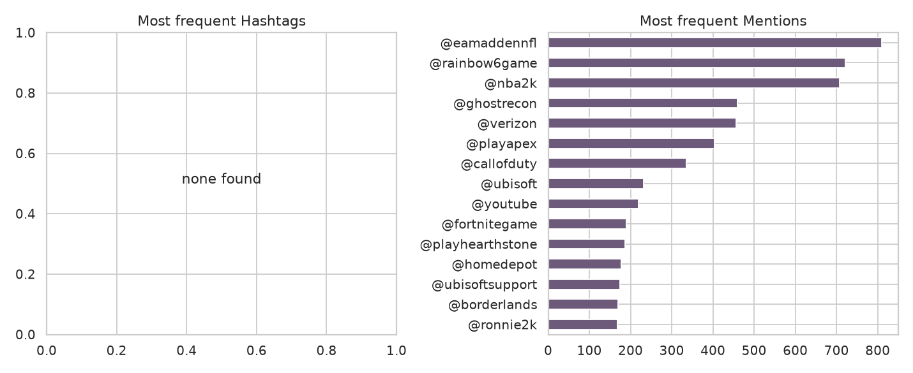
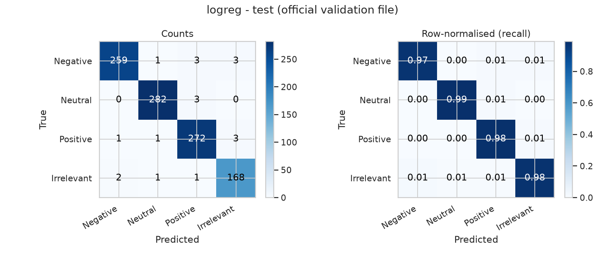
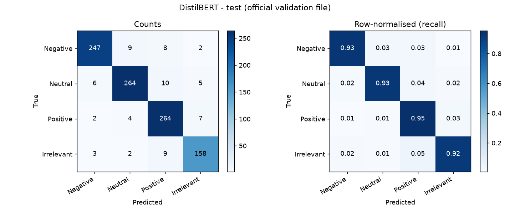
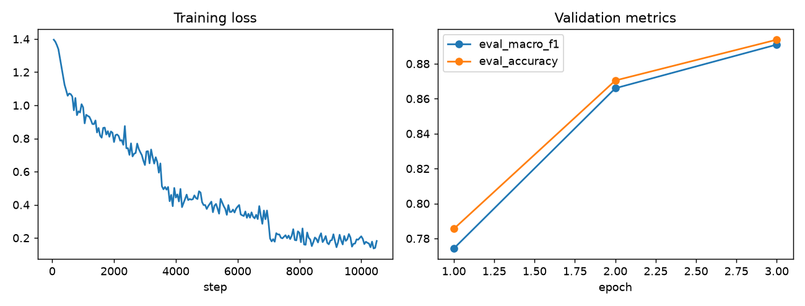

# Social Media Sentiment Analysis and Topic Modeling Dashboard

BrandWatch Analytics project: four-class Twitter sentiment classification, exploratory analysis, topic modeling, deep-learning baselines, and a Streamlit dashboard.

  

**Quick links:** [Results](#results) · [Setup](#setup) · [Run](#run) · [Evaluation protocol](#evaluation-protocol) · [Known limitations](#known-limitations) · [`AUDIT_REPORT.md`](AUDIT_REPORT.md) · [`docs/requirements_traceability.md`](docs/requirements_traceability.md)

---

## Table of Contents

1. [Overview](#overview)
2. [Packaging status](#packaging-status)
3. [Dataset](#dataset)
4. [Results](#results)
5. [Topic modeling](#topic-modeling)
6. [Dashboard](#dashboard)
7. [Project structure](#project-structure)
8. [Setup](#setup)
9. [Run](#run)
10. [Label modes](#label-modes)
11. [Evaluation protocol](#evaluation-protocol)
12. [Key artifacts](#key-artifacts)
13. [Known limitations](#known-limitations)

---

## Overview

| | |
|---|---|
| **Task** | Four-class sentiment: `Negative`, `Neutral`, `Positive`, `Irrelevant` |
| **Models** | Logistic Regression, Linear SVM, Naive Bayes, Random Forest (TF-IDF); CNN, LSTM, Attention; fine-tuned DistilBERT |
| **Unsupervised** | LDA, KMeans, NMF, pyLDAvis, human topic-review sheet |
| **App** | Streamlit dashboard (live prediction, entity sentiment, topics, model comparison, DL experiments) |
| **Best classical result** | Logistic Regression, 98.1% accuracy / 98.0% macro-F1 on the held-out 1,000-row set |
| **DistilBERT** | 93.3% accuracy on the same held-out set (below the linear models) |

> **Honest headline:** on this dataset, current evidence does **not** show transformers outperforming strong linear TF-IDF baselines. See [Known limitations](#known-limitations) before treating any number as real-world performance.

---

## Packaging status

Depending on how this project is shared, the archive may be **partial**. A source-only archive contains code, precomputed results, plots, split CSVs and topic artifacts, but **not**:

- `models/` trained model binaries
- the raw CSVs `twitter_training.csv` and `twitter_validation.csv`
- the original environment documentation

Without them the saved metrics are historical artifacts: saved-model verification and model-backed inference cannot be reproduced until the files are restored or the models are retrained. The full audited tree (with `data/` and `models/four/`) includes them.

The dataset is the **Twitter Entity Sentiment Analysis** dataset. It is **not** the original brief's 31,962-row, three-class specification; see [`docs/requirements_traceability.md`](docs/requirements_traceability.md).

---

## Dataset

- Raw training file: 74,682 rows; official validation file: 1,000 rows; four labels.
- Modeling splits (`results/four/splits/`): train / val / test CSVs. The train+val EDA covers **65,954** records; the difference from the raw count should be checked in `results/four/metrics/data_validation.json`.

| Class | Records | Share |
|---|---:|---:|
| Negative | 20,314 | 30.8% |
| Positive | 17,911 | 27.2% |
| Neutral | 16,120 | 24.4% |
| Irrelevant | 11,609 | 17.6% |
| **Total** | **65,954** | **100%** |

Class imbalance is moderate (largest/smallest ≈ 1.75), so macro-F1 is reported alongside accuracy.



**Entities** have similar volume (~2,000–2,200 tweets each) but very different sentiment mixes, e.g. roughly 73% negative for MaddenNFL versus roughly 15% for WorldOfCraft (approximate chart readings; exact values in `results/four/metrics/entity_sentiment.csv`).



| Length distributions | Hashtags & mentions |
|:---:|:---:|
|  |  |

Data-quality observations from n-grams: URL remnants (`com`, `pic twitter com`), repeated templated text in the `Irrelevant` class, and no extractable hashtags. More EDA figures: `eda_top_unigrams.png`, `eda_top_bigrams.png`, `eda_top_trigrams.png`, `eda_top_entities.png`, `eda_wordclouds.png`.

---

## Results

### Held-out test set (official validation file, 1,000 rows)

| Model | Accuracy | Macro-F1 | F1 (Irrelevant) |
|---|---:|---:|---:|
| Logistic Regression | 98.1% | 98.0% | 97.1% |
| Linear SVM | 98.0% | 97.9% | 97.4% |
| Naive Bayes | 96.6% | 96.5% | 95.6% |
| Random Forest | 94.7% | 94.6% | 94.0% |
| DistilBERT | 93.3% | 93.2% | 91.9% |

Computed from the saved confusion matrices; full tables in `results/four/metrics/` (`leaderboard.csv`, `leaderboard.md`, `per_class_metrics.csv`, `model_comparison.csv`). Deep baselines (CNN / LSTM / Attention): `results/four/deep_baselines/summary.csv`.

| Logistic Regression | DistilBERT |
|:---:|:---:|
|  |  |

### DistilBERT fine-tuning (internal validation split)

| Epoch | Accuracy | Macro-F1 |
|---:|---:|---:|
| 1 | 78.56% | 77.45% |
| 2 | 87.03% | 86.58% |
| 3 | **89.37%** | **89.06%** |



> 89.37% is accuracy on the internal validation split used during tuning; 93.3% is accuracy on the held-out test set. They are different evaluation sets and must not be compared directly.

---

## Topic modeling

LDA (with pyLDAvis), KMeans on TF-IDF, and NMF, plus a human review sheet applied via `scripts/apply_topic_review.py`. Outputs in `results/four/topics/`; model-selection curves in `results/four/metrics/` (`lda_`, `kmeans_`, `nmf_k_selection.csv`).

---

## Dashboard

| Overview | Model Performance |
|:---:|:---:|
|  |  |

| Live testing | Topic exploration |
|:---:|:---:|
|  |  |

All screenshots: [`streamlit screenshots/`](streamlit%20screenshots).

---

## Project structure

```
.
├── app.py                      # Streamlit dashboard
├── health_check.py             # Project health check (logs in reports/health_check/)
├── requirements.txt
├── AUDIT_REPORT.md  CHANGELOG.md  VALIDATION_CHECKLIST.md
├── data/                       # twitter_training.csv, twitter_validation.csv
├── docs/requirements_traceability.md
├── models/four/                # classical/*.joblib, distilbert/, topic_models.joblib, label_map.json
├── results/four/
│   ├── deep_baselines/         # CNN / LSTM / Attention (plus *_smoke dirs = quick test runs)
│   ├── figures/  metrics/  splits/  topics/  reports/
├── scripts/                    # run_all, cv_classical, train_deep_baselines,
│                               # verify_models, diagnose_distilbert, apply_topic_review
├── src/                        # data, preprocessing, eda, classical, deep_models,
│                               # transformer, topics, evaluation, sentiment, report, config
├── streamlit screenshots/
└── tests/
```

---

## Setup

Python 3.10–3.12 is recommended. From the project root:

```bash
python -m venv .venv
source .venv/bin/activate
python -m pip install --upgrade pip
pip install -r requirements.txt
```

For a minimal CPU-only classical workflow, install the core dependencies first and omit `torch`, `transformers` and `accelerate` unless you use the transformer / deep-learning scripts.

### Data

Place `twitter_training.csv` and `twitter_validation.csv` under `data/`, or set `TSP_DATA_DIR` to the directory containing them. Existing processed splits are under `results/four/splits/`, but the normal data-preparation stage expects the source files.

---

## Run

```bash
# Tests that do not require Streamlit
python -m pytest -q tests/test_preprocessing.py tests/test_deep_models.py \
    tests/test_topic_review.py tests/test_report_verification.py

# Compile source and scripts
python -m compileall -q src scripts app.py

# Rebuild data and classical/topic artifacts (requires raw data)
python scripts/run_all.py --stages data eda classical topics report --label-mode four

# Verify saved models (requires model binaries under models/four/)
python scripts/verify_models.py --label-mode four --skip-transformer

# Start the dashboard (requires Streamlit, model artifacts and data)
streamlit run app.py
```

To run the full suite including `tests/test_app_smoke.py`, install the requirements first. Transformer training is expensive and is **not** run by the default pipeline; use it only after confirming data, dependencies and hardware. Other scripts: `scripts/cv_classical.py`, `scripts/train_deep_baselines.py`, `scripts/diagnose_distilbert.py`.

---

## Label modes

| Mode | Behavior |
|---|---|
| `four` (primary) | Keeps all four original labels |
| `three_exclude` | Excludes `Irrelevant` rows |
| `three_merge` | Explicitly maps `Irrelevant` to `Neutral` |

Do not compare metrics across label modes as if they were the same experiment. The three-class modes are alternative experiments, not evidence that the data is naturally three-class.

---

## Evaluation protocol

A stratified internal validation split from the official training data is used for model selection; the official validation file is reserved as held-out test data. Do not tune hyperparameters against the held-out test set. The selected classical model is chosen by validation macro-F1, not test performance.

---

## Key artifacts

| Path | Contents |
|---|---|
| `results/four/metrics/` | Historical metrics, leaderboard, verification report, near-duplicate diagnostics |
| `results/four/figures/` | EDA and confusion-matrix figures |
| `results/four/topics/` | Topic assignments, summaries, labels, review sheet, pyLDAvis HTML |
| `results/four/reports/final_report.md` | Historical pipeline report |
| `AUDIT_REPORT.md` | Audit findings, execution results, remaining blockers |
| `docs/requirements_traceability.md` | Requirement-by-requirement status |

---

## Known limitations

- **Possible leakage / small test set.** The held-out set has 1,000 rows (1 point = 10 records; the LogReg vs. SVM gap is one record), and 96–98% is high for social text. Review `near_duplicate_diagnostic.json` and `near_duplicate_by_model.csv` before trusting these numbers.
- **Packaging.** Source-only archives lack model binaries and raw data (see [Packaging status](#packaging-status)).
- **Streamlit** may not be installed in a given environment, so dashboard smoke tests may not be collected.
- **DistilBERT verification** metadata records failed metric-match checks; with binaries absent, the precision discrepancy cannot be resolved from a source-only archive.
- **LDA topic count.** The saved topic summary selects 12 LDA topics, outside the requested 15–20 range. The selector now chooses the best coherence only among 15 and 20 after comparing the broader grid; saved topic artifacts remain historical until regenerated.
- **Topic review pending.** The review sheet has blank reviewer/notes fields.
- **pyLDAvis HTML** exists, but browser rendering was not verified.
- **Temporal, network and geographic analysis** are blocked unless compatible timestamps, interaction identifiers or coordinates are supplied.
- **URL remnants** (`com`, `pic twitter com`) remain in text and dominate some n-gram charts.
